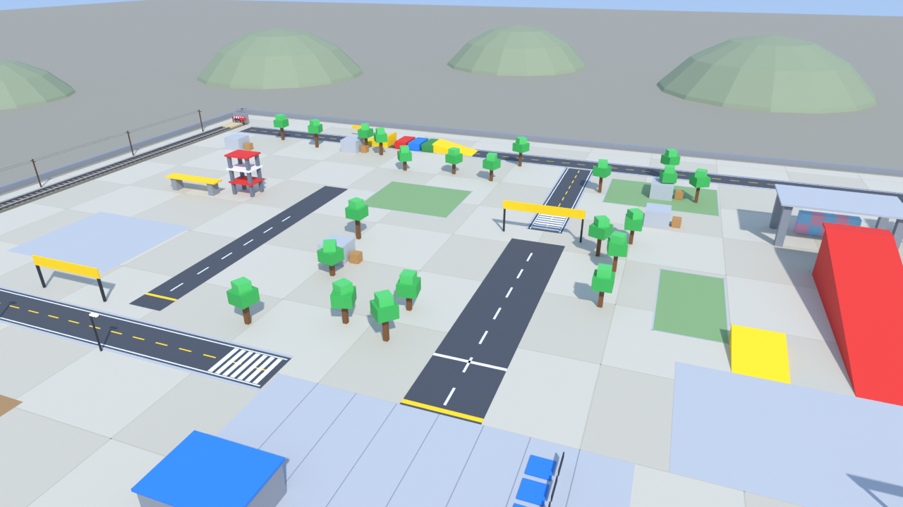
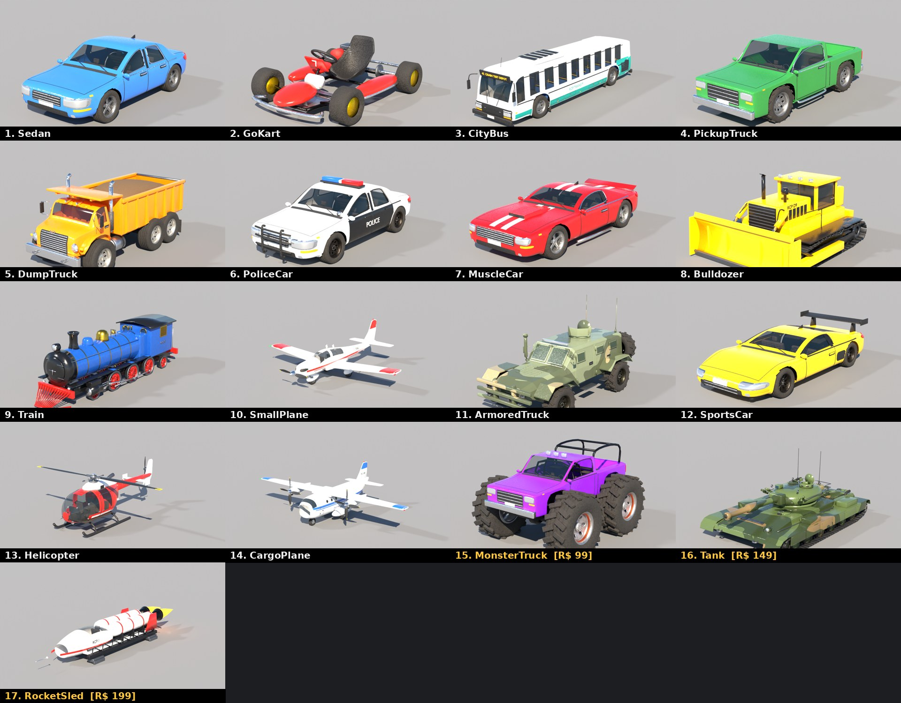

# RAGDOLL CRASH PHYSICS

A Roblox vehicle-crash sandbox: spawn a vehicle, drive or fly it into grey ragdoll test dummies, read what broke, reset, repeat.

## Open it in Roblox Studio

1. Open **`RagdollCrashPhysics.rbxlx`** in Roblox Studio (File > Open from File). Every script, the UI, the audio, the dummies and the whole Test Grounds map are already in it. The map sits in `Workspace.Map`, so you can see and edit it before pressing Play; the server uses that map as-is.
2. Add the detailed vehicle models (one import): File > **Import 3D** > `blender/out/AllVehicles.glb`, keep the default options, then drag the imported model into `ReplicatedStorage.VehicleMeshes`. Each vehicle switches from its blocky stand-in to the detailed model automatically. (Single vehicles: `blender/out/<Vehicle>.glb`.)
3. File > Publish to Roblox. In Game Settings set **Max Players = 1** (one sandbox per server), and under Security turn on **Allow HTTP requests** only if you add web features later (not needed now).
4. Optional: paste your uploaded Folk UI / icon pack image ids into `UIAssets` (StarterPlayer > StarterPlayerScripts > Client > UIAssets).

Rebuild the place from source with `cd roblox && rojo build -o place.rbxl && lune run tools/bake_place.luau place.rbxl ../RagdollCrashPhysics.rbxlx`.

| Folder | What is in it |
|---|---|
| `roblox/` | The game: a Rojo project (`rojo build -o RagdollCrashPhysics.rbxlx`), 29 Luau modules, tests |
| `blender/` | Procedural Blender modelling code and the 17 finished vehicle models (`out/*.blend`, `*.glb`, renders) |
| `docs/` | `vehicles.jpg` (all models, in unlock order), `side_views.jpg` (cars and trucks side-on: windows, doors, sharp truck cab), `four_door.jpg` (sedan and police car: side, front and rear three-quarter), `map_topdown.png` (map render) |

## Research (live Roblox data, 15-16 Nov 2026)

Player counts were read from the Roblox games API; pages and store screenshots of each game were reviewed.

| Game | Playing | Server | What it does that matters here |
|---|---|---|---|
| Bloody Ragdoll Physics | ~55k | 1 player | Grey articulated dummies with the Man face, flat tiled plaza, scaffold towers, drivable cars, slow motion + rewind |
| Ragdoll Physics | ~37k | 1 player | Minimal tiled baseplate, tools only |
| Ragdoll Destruction Playground | ~20k | 1 player | Destructible props, slow motion, "reset your map" |
| Ragdoll Research | ~19k | 1 player | Man-face dummies, crash-test cars, crushers, tall buildings |
| Ragdoll Playground | ~19k | 6 players | 2D sandbox, time stop |
| Realistic Ragdoll Engine | ~5k | 1 player | Bright green tiled ground, grey concrete blocks, crates, several maps, dummies stumble / faint / crawl |
| Ragdoll Reality | ~5k | 6 players | Per-limb reactions, limping / crawling, 80-stud tower |
| Realistic Ragdoll Playground | ~2.5k | 1 player | Active ragdolls that get back up, cars |
| Ragdoll Sandbox Bloodful | ~40 | 15 players | Floating "Dummy / Dead" labels |

Two of the six games in the original brief could not be read: *Hyper Realistic Ragdoll* returns "unavailable" from the API and *Ragdoll Fight Testing* has no universe. Nothing about them is assumed.

What was taken from the research: one-player servers, grey Robloxian-style dummies with the Man face, a bright tiled green ground with grey concrete structures and low-poly trees, multiple maps, slow-motion replay. What is different: vehicles are the tools (17 of them), and every hit is reported by body part, injury and blood %. No proprietary scripts, meshes, images or sounds from those games are used.

## The game

- **Dummies** are real R15 avatars built at runtime from Roblox's own catalog parts: the Robloxian 2.0 body (bundle 311) and the animatable Man head (`Man Face - Head`, 10725826963), all grey. Body type can be switched in game (Man / Robloxian 2.0 / Blocky). The face is driven through `FaceControls`: shock on impact, pain when hurt, rolling eyes when dizzy, shut eyes when knocked out. If the avatar service is unavailable the game falls back to a part-built blocky dummy with a drawn Man-style face.
- **Damage** is tracked per region (head, torso, each arm and leg) with health, blood %, bleeding, consciousness and 11 statuses, all decided on the server (`shared/DamageModel.luau`).
- **Read-out**: one two-line text bar at the bottom of the screen, never more than three facts: `Left Knee` / `Leg shattered · Knocked out · 95% blood left`. Pile-ups collapse to `6 dummies hit` / `3 down · 2 knocked out · 1 dead`.
- **Vehicles**: sedan, sports car, police car, muscle car, pickup, monster truck, city bus, dump truck, tank, armoured truck, light plane, cargo plane, helicopter, steam train, bulldozer, go-kart, rocket sled. Cars, tracked vehicles, planes, the helicopter and the train each have their own handling model.
- **Crashes**: hitting a wall hard (or the ground, in an aircraft) ends in an explosion: fireball, smoke, sparks, shockwave, a physical blast that throws nearby dummies and props, and a burning wreck.
- **Maps**: Test Grounds, Downtown and Desert Range share one zone layout (plaza, dummy field, crash track, ramps, airfield, heavy-vehicle field, destruction yard). The floor is a two-tone tiled concrete test ground like the researched sandboxes, with a few lawns instead of a green field. Asphalt roads with kerbs, lane markings and crossings link every zone; the north road has a stunt jump over parked containers and the south road has kickers. A ballasted railway runs the length of the map past a station and a level crossing and ends in a buffer stop.
- **UI**: Shop / Vehicles / Sandbox tiles on the left, round Settings / Dummy / Controls buttons on top, packs and Revive / Reset on the right, key binds bottom right while driving (a slim strip under the top row on phones and tablets). Gamepad glyphs replace key caps when a controller is used.
- **Replay**: the last 10 seconds can be watched at 0.25x-1x. It plays recorded transforms on local copies, so it cannot change the simulation.

## Unlocks and Robux vehicles

Vehicles are ranked from least to most cool. Players start with the **Sedan**; the next 13 unlock in order as their lifetime **crash points** grow (shown under the title, with the next unlock):

| # | Vehicle | Crash points | | # | Vehicle | Crash points |
|---|---|---|---|---|---|---|
| 1 | Sedan | free | | 8 | Bulldozer | 34,000 |
| 2 | Go-Kart | 1,500 | | 9 | Train | 43,000 |
| 3 | City Bus | 4,000 | | 10 | Small Plane | 53,000 |
| 4 | Pickup Truck | 8,000 | | 11 | Armored Truck | 64,000 |
| 5 | Dump Truck | 13,000 | | 12 | Sports Car | 76,000 |
| 6 | Police Car | 19,000 | | 13 | Helicopter | 90,000 |
| 7 | Muscle Car | 26,000 | | 14 | Cargo Plane | 110,000 |

The three coolest are Robux game passes: **Monster Truck (R$ 99), Tank (R$ 149), Rocket Sled (R$ 199)**. Points come only from crash reports that a vehicle started (events and chain reactions earn nothing), capped at 15,000 per crash. The server checks every spawn; locked cards show the points still needed, paid cards open the purchase prompt. Progress saves to a DataStore (`RCP_Progress_v1`) with `UpdateAsync` keeping the larger total, so a failed save can't lose points; if DataStores are unavailable the game keeps going with session-only progress and tells the player.

To switch the paid vehicles on: Creator Dashboard > your experience > Monetization > Passes > create three passes, then paste their ids into `Config.Progression.Paid` in `ReplicatedStorage.Shared.GameConfig`; until then they show "SOON". The order, the point costs and the prices are all in that table. For testing in Studio: Game Settings > Security > **Enable Studio Access to API Services** (for saving), and `StudioUnlockAll = true` makes every vehicle usable in Studio only.

## Models

`blender/build_realistic.py` builds every vehicle from code (`python3 build_realistic.py [Vehicle ...]`, needs the `bpy` module or Blender 4.2+). Bodies are lofted and subdivided surfaces with real glass, cut wheel arches and interiors; lamps, grilles, shut-lines and liveries are projected onto the surface; wheels have tyres with tread, rims, spokes and brakes; the tank and bulldozer have individual track links; aircraft use aerofoil sections and twisted blades.

**Body shapes, doors and windows.** Door and handle placement is measured off real side views and scaled by wheel radius (r). On an SUV the front door starts about 1.3 r behind the front wheel centre and is about 0.41 of the wheelbase long. Its handle sits about 0.13 r under the beltline and is about 0.67 r long, ending 0.17 r from the door's rear edge (0.38 r on a rear door). The fuel door sits 0.28 r behind the rear wheel centre. On a coupe the door is about 0.48 of the wheelbase and starts 2.24 r behind the front wheel; its handle is lower and further back. Every side window is one pane that fills the whole top of its door, from the beltline up to the roof rail and forward under the A-pillar. There is no split quarter glass and no double window. The 4-door, 4-seat cars (sedan, police car) are laid out from a real midsize sedan, the 2024-25 Toyota Camry and Honda Accord, scaled by the wheelbase:
- The real cars have a 111 in wheelbase, are about 193 in long and 57 in high.
- Rear headroom is only about 0.7 in less than the front, so the roof stays high over the back seat and only then falls to the rear screen.
- The front door is about 40 in long and runs from just behind the front arch to a slim B-pillar, which latches the front door and hinges the rear one.
- The rear door is about 38 in at the beltline. It runs back over the rear wheel arch, where the base of the C-pillar sits, and curves round the arch below.
- The rear side window runs right back to a raked rear edge that follows the C-pillar. The rear door's frame runs up the pillar behind it.

The pickup and monster truck are built sharp, like real trucks:
- flat vertical sides and a flat roof with hard creases at the cowl, windscreen header, roof edge and rear-screen base (they survive subdivision);
- an upright rear screen and a solid rear pillar behind a flat-topped door window;
- a separate bed with a visible gap behind the cab;
- a blunt, upright nose and a flat tailgate;
- squared-off wheel arches.

The bus and dump truck use the same sharp sections; the armoured truck is flat, faceted armour plate. A build-time check stops any body whose cross-sections are out of order. Out-of-order sections were what folded the bonnet over the front wheel on the cars.

**Textures.** `blender/texture_vehicles.py` gives every vehicle a full PBR texture set (colour, roughness, metalness, normal), baked from original procedural materials in the style of the researched games: clear-coated paint with orange peel, chipped edges down to primer and bare metal, crevice grime, road dirt sprayed up the sills and wheels, dust on top surfaces, brushed and scratched metal, grained tyre rubber, plastic grain, seat weave, aircraft panel lines, military camouflage (tank, armoured truck), rust (dump truck, bulldozer) and soot (train, rocket sled). Wear is set per vehicle: the sports car is nearly showroom clean, the bulldozer is caked. Body, trim, turret, wheel and rotor meshes are textured (1024 px for bodies and trim, 512 or 256 px for wheels and rotors); glass and lamps keep their plain glass and glow materials. Five looks were made per vehicle (`python3 texture_vehicles.py preview`: Factory Clean, Daily Use, Battered, Two-Tone Livery or Arctic Camo, Matte Rally or Desert Camo). Look 1, **Factory Clean**, is the one applied to every vehicle (`python3 texture_vehicles.py apply all=1`). No textures were taken from other games. Maps are written to `blender/out/textures/<Vehicle>/` and embedded (JPEG) in every `.glb`, so Import 3D creates a `SurfaceAppearance` on each mesh automatically; the game keeps it.

To use them in the game: in Studio open **File > Import 3D**, import `blender/out/<Vehicle>.glb` into `ReplicatedStorage.VehicleMeshes` as a Model named exactly `<Vehicle>` (keep the object names). Each object is under 20,000 triangles and carries baked vertex colours. `shared/VehicleMeshInfo.luau` (generated) tells the game where each mesh sits, so nothing has to be positioned by hand. Until a vehicle is imported the game shows its part-built version, which is also the collision body.

## Audio and UI art

Every sound is a Creator Store asset found through the Roblox audio search; names, creators and lengths are listed beside each ID in `roblox/src/shared/AudioIds.luau`.

UI icons and textures are slots in `roblox/src/client/UIAssets.luau`. They are empty, so the UI draws its own simple vector icons. To skin it with the Folk UI kit and an icon pack you hold the licence for, upload the images to Roblox and paste the asset ids into that file.

## What has and has not been tested

Roblox Studio cannot run in the environment this was built in, so **nothing has been play-tested in the engine**. What was run:

| Suite (`lune run tests/<name>.luau`) | Checks | What it proves |
|---|---|---|
| `syntax_check` | 30 files | Every script compiles |
| `damage_spec` | 86 | Damage curve, regions, statuses, blood, revive |
| `builders_spec` | 922 | All 17 vehicles and 5 dummy types build against the Roblox API database |
| `map_spec` | 210 | Map builds; every spawn and preset dummy stands on something solid |
| `place_spec` | 12 | The finished place file has every script in the right container, the baked map, and the server reuses it |
| `integration_spec` | 135 | The real server and client scripts run end to end on a mock engine: boot, a 56 mph crash, one hit per dummy, crash report, explosion, revive, resets without leaks, presets, limits, hostile requests, events, body and map switching, the whole UI with every button pressed, crash points unlocking vehicles in order, locked spawns refused, Robux pass purchase and ownership, saving |

Not verified, and needing a pass in Studio: vehicle handling feel and stability, ragdoll joint limits on the Robloxian rig, the `FaceControls` expressions, the look of the particle effects, hinge axis directions (wheels, propellers, turret), the orientation and colours of the imported meshes, and frame rate. The map is built for speed (streaming on, shadows off for flat and small parts, no touch events, about 730 static parts and 175 loose props, capped dummies) but the 100 fps target has not been measured.
